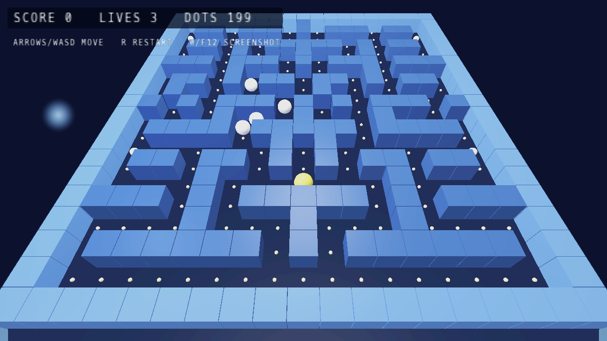

# Exo

A simple and performant 3D game engine built on the
<a href="https://github.com/spectrelang/spectre">Spectre</a> programming
language.

The engine has no built-in notion of a level list, player, camera controller,
goal, score, or key bindings. Games receive raw input/lifecycle events and own
all gameplay state.

Run the bundled showcase with:

```sh
spectre run examples/pacman3d.sx
```

Or:

```sh
spectre examples/pacman3d.sx
./s-out/pacman3d
```

## Screenshot



## Library Layout (as of v0.0.2)

| Module               | Responsibility                                               |
| -------------------- | ------------------------------------------------------------ |
| `engine.sx`          | App lifecycle, generic event loop, scene/resource management |
| `engine/sdl.sx`      | SDL3 bindings, event structs, constants, link directives     |
| `engine/math.sx`     | `Vec3`, `Vec4f`, `Mat4`, and math helpers                    |
| `engine/camera.sx`   | Optional fly-camera state and view/projection                |
| `engine/input.sx`    | Input configuration, state, event helpers, gamepad polling   |
| `engine/audio.sx`    | WAV loading and multi-clip playback                          |
| `engine/shaders.sx`  | Shader paths and platform shader format                      |
| `engine/io.sx`       | Binary file loading                                          |
| `engine/glb.sx`      | GLB parsing and bounds                                       |
| `engine/mesh.sx`     | Procedural meshes and GLB mesh upload                        |
| `engine/renderer.sx` | SDL_GPU renderer, scene passes, HUD pipeline                 |
| `ecs.sx`             | Generic scene/entity/render/UI data model                    |
| `physics.sx`         | Gravity, floor collision, and collision/query helpers        |

Every module can be imported directly, so gameplay code can depend on only the
parts it needs.

## Example Usage

```spectre
val ecs       = use("ecs.sx")
val engine    = use("engine.sx")
val rendering = use("rendering.sx")
val physics   = use("physics.sx")
val sdl       = use("engine/sdl.sx")
val input     = use("engine/input.sx")
val audio     = use("engine/audio.sx")

fn build_scene() ecs.Scene3D = {
    val scene: mut ecs.Scene3D = ecs.new_scene()
    ecs.add_light(scene, ecs.make_light(
        ecs.make_vec3(0.0 as f32, 4.0 as f32, 1.0 as f32),
        ecs.make_vec3(1.0 as f32, 1.0 as f32, 1.0 as f32),
        1.8 as f32,
        8.0 as f32
    ))

    scene.gravity = 9.8 as f32
    ecs.add_floor(scene, ecs.make_floor(0.0 as f32, 0.25 as f32))

    @append(scene.cubes, ecs.make_cube(
        ecs.make_vec3(0.0 as f32, 0.0 as f32, -2.5 as f32),
        ecs.make_vec3(0.25 as f32, 0.72 as f32, 1.00 as f32),
        1.0 as f32,
        1.0 as f32
    ))

    @append(scene.spheres, ecs.make_sphere(
        ecs.make_vec3(1.8 as f32, 0.0 as f32, -3.0 as f32),
        ecs.make_vec3(1.00 as f32, 0.42 as f32, 0.32 as f32),
        0.7 as f32
    ))

    return scene
}

type (engine.AppEvents) MyGame = {
    score: mut i32
}

pub fn (MyGame) on_start(_: mut self, _: mut engine.ExoApp) void = {}
pub fn (MyGame) on_shutdown(_: mut self, _: mut engine.ExoApp) void = {}
pub fn (MyGame) on_update(_: mut self, app: mut engine.ExoApp, dt: f32, _: f32) void = {
    physics.update_physics(app.scene, dt)
}
pub fn (MyGame) on_fixed_update(_: mut self, _: mut engine.ExoApp, _: f32) void = {}
pub fn (MyGame) on_key_up(_: mut self, _: mut engine.ExoApp, _: i32, _: u16) void = {}
pub fn (MyGame) on_key_down(game: mut self, app: mut engine.ExoApp, key: i32, _: bool, _: u16) void = {
    if key == sdl.SDL_SCANCODE_SPACE {
        game.score = game.score + 1
        trust engine.play_sound(app)
    }
    if key == sdl.SDL_SCANCODE_ESCAPE {
        engine.request_quit(app)
    }
}
pub fn (MyGame) on_mouse_move(_: mut self, _: mut engine.ExoApp, _: f32, _: f32, _: f32, _: f32) void = {}
pub fn (MyGame) on_mouse_button(_: mut self, _: mut engine.ExoApp, _: u8, _: bool, _: u8, _: f32, _: f32) void = {}
pub fn (MyGame) on_mouse_wheel(_: mut self, _: mut engine.ExoApp, _: f32, _: f32, _: f32, _: f32) void = {}
pub fn (MyGame) on_text_input(_: mut self, _: mut engine.ExoApp, _: ref u8) void = {}
pub fn (MyGame) on_window_resize(_: mut self, _: mut engine.ExoApp, _: i32, _: i32) void = {}
pub fn (MyGame) on_focus_changed(_: mut self, _: mut engine.ExoApp, _: bool) void = {}
pub fn (MyGame) on_gamepad_button(_: mut self, _: mut engine.ExoApp, _: i32, _: bool) void = {}
pub fn (MyGame) on_gamepad_axis(_: mut self, _: mut engine.ExoApp, _: i32, _: f32) void = {}

pub fn main() i32 = {
    val input_cfg: input.InputConfig = {
        keys: rendering.default_key_bindings(),
        mouse: {
            enabled: true,
            sensitivity_x: 0.0018 as f32,
            sensitivity_y: 0.0018 as f32,
            invert_y: false
        },
        text_input: false,
        gamepad: true
    }
    val audio_cfg: audio.AudioBankConfig = {
        master_volume: 96 as i32,
        clips: [{
            path: "./assets/example_sound.wav",
            loops: 0 as i32,
            volume: 96 as i32
        }]
    }

    val builder: mut engine.ExoAppBuilder = engine.new_app()
    engine.with_title(builder, "Hello World")
    engine.with_resolution(builder, 1280 as i32, 720 as i32)
    engine.with_scene(builder, build_scene())
    engine.with_default_camera(builder)
    engine.with_auto_camera(builder)      // omit for a custom camera
    engine.with_input(builder, input_cfg)
    engine.with_audio(builder, audio_cfg)

    val app: engine.ExoApp = engine.build_app(builder)
    val game: MyGame = { score: 0 as i32 }
    return trust engine.run_app_with_events[MyGame](app, game)
}
```

---

License: GPL-3.0-only
